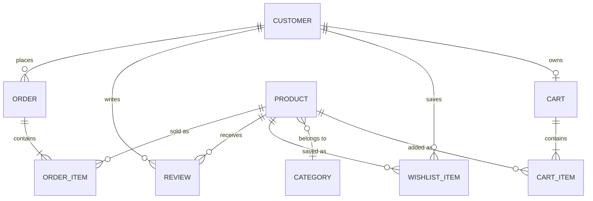

# Data model

TypeScript definitions live in [`lib/types.ts`](../lib/types.ts). The demo uses
in-repo mock data (`lib/data/*`), but the entities map directly to a relational
schema or a headless commerce backend (Shopify, Medusa, Saleor).

| Entity | Key fields | Notes |
| --- | --- | --- |
| **Customer** | id, email, firstName, lastName, phone, acceptsMarketing, createdAt | Guest checkout creates/updates by email |
| **Category** | slug, name, description, image | dresses · tops · bottoms · outerwear |
| **Product** | id, slug, sku, category, price, compareAtPrice, colors[], sizes[], lowStock[], images[], badge, isNew, isBestseller, rating, reviewCount, popularity, createdAt, description, details[], fabric, care[], fit | Variant = product × colour × size; SKU suffixes encode the variant |
| **Cart** | id, items[], email?, updatedAt | Persisted client-side in the demo; `email` enables abandoned-cart recovery |
| **CartItem** | lineId, productId, color, size, quantity, unitPrice | `lineId = productId__color__size` merges duplicates |
| **Order** | id, number (EL-xxxxx), customerEmail, shippingAddress, items[], shippingMethod, subtotal, shipping, total, currency, status, createdAt | Totals always computed server-side (`lib/commerce.ts`) |
| **OrderItem** | productId, sku, name, color, size, quantity, unitPrice, lineTotal | Snapshot of price at purchase time |
| **WishlistItem** | productId, addedAt | Device-local in the demo |
| **Review** | id, productId, author, rating, title, body, sizePurchased, fit, verified, createdAt | New reviews are unverified until moderated |
| **NewsletterSubscriber** | id, email, source, subscribedAt | Source = footer / popup / checkout |
| **ContactInquiry** | id, name, email, subject, message, topic?, orderNumber?, createdAt | `topic` is filled in by the n8n AI classifier |

## Order status lifecycle

`pending → paid → processing → shipped → delivered`, with `cancelled` and
`refunded` as terminal branches. The AI assistant and `/account` order lookup
read this status.

## Business rules

* Free standard shipping at **$100+** (`FREE_SHIPPING_THRESHOLD`), otherwise $8; express $18.
* Quantity per line is capped at 10.
* The server rejects colours or sizes a product doesn't offer, and ignores any client-sent prices.
* Card data never reaches the server; in production it goes to the payment provider's hosted fields.
